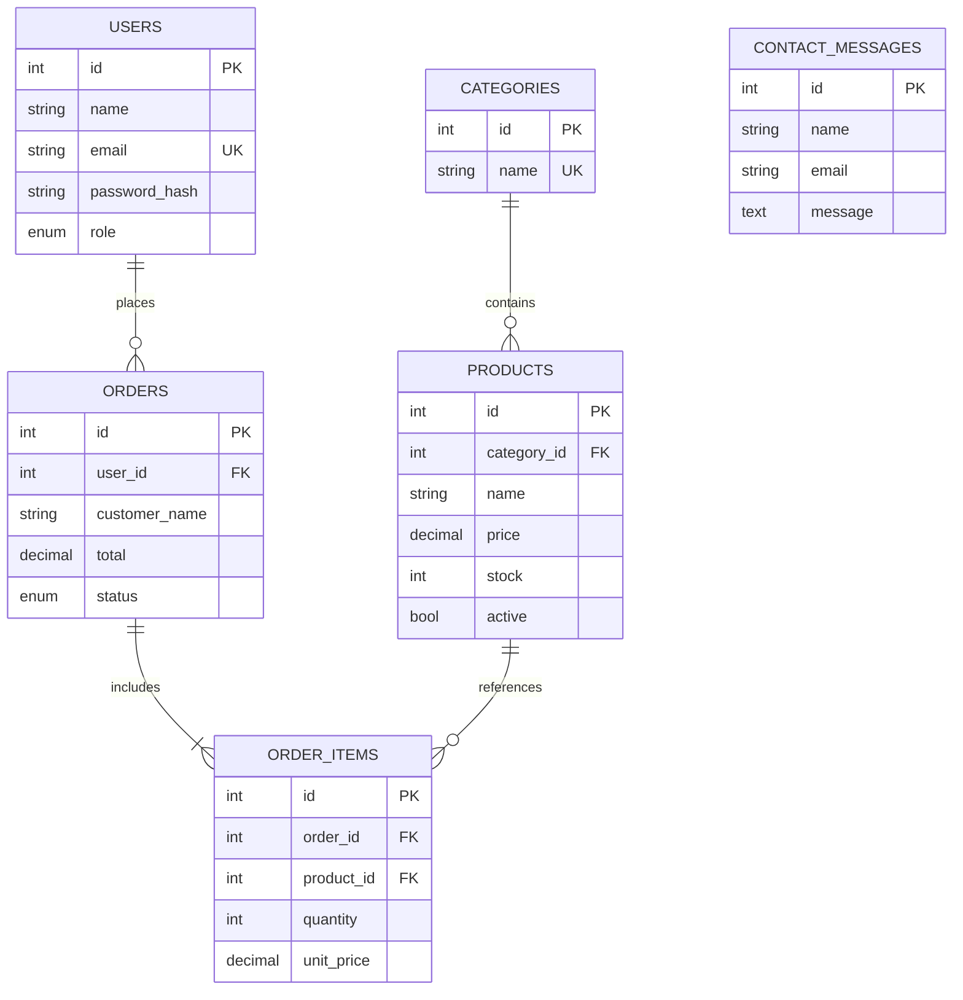

# M3 — Entity-Relationship Diagram and Relational Schema

- PKs are auto-increment unsigned integers. Unique keys: users.email, categories.name and (order_id, product_id) in order_items.
- Foreign keys: products.category_id → categories.id; orders.user_id → users.id; order_items.order_id → orders.id; order_items.product_id → products.id.
- Orders and items are separate tables so one order contains multiple products with snapshot unit prices. This avoids repeating product data and preserves checkout history.
- Contact messages are independent submissions and do not require user accounts.
- Price is `DECIMAL(10,2)` and quantity/stock are unsigned integers. Checks apply to prices and order item quantities.
- Referential integrity and consistent stock changes are enforced by InnoDB transaction boundaries.

See exact executable schema in `database/schema.sql` and initial dataset in `database/seed.sql`.
